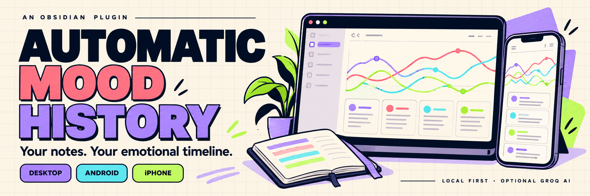

# Automatic Mood History



**Your notes. Your emotional timeline.**

Turn your [Obsidian](https://obsidian.md/) journal into a mood history you can explore on **desktop, Android and iPhone**. See mood, energy, connection and intensity trends, emotion patterns, and the original notes behind each day.

Start with offline analysis that runs inside Obsidian. Optionally connect Groq for contextual AI analysis, or add the offline Moodring emotion classifier. You choose which folders to include and whether analysis runs automatically.

**[Download the latest release](https://github.com/remriel/automatic-mood-history/releases/latest)** · [Mobile setup](#android-and-iphone) · [Installation](#installation) · [Privacy](#privacy)

*Banner artwork is illustrative; it does not show personal mood data or an exact app screenshot.*

## Features

- Desktop, Android and iPhone support, with responsive layouts and touch-friendly controls
- Optional automatic analysis after changes to included notes
- Folder include/exclude lists, with subfolder support and exclusions taking precedence
- One consolidated result per calendar date
- Optional Groq structured-output analysis with GoEmotions-informed vocabulary and a validated three-stage JSON fallback
- Local VADER sentiment scoring that works without a network connection or API key
- Native Markdown entry notes and an Obsidian Base
- Mood, energy, connection, and intensity scores from 1–5, all plotted in the trend chart
- Dominant-emotion history and day-by-day source links
- Light and dark themes with a colorful neo-brutalist dashboard that adapts to Obsidian theme colors
- Source hashes so unchanged notes are skipped
- Empty and image-only days marked as insufficient evidence instead of receiving invented scores

## Privacy

This plugin can transmit cleaned text from eligible Markdown notes created on a selected day to Groq for analysis **only after you enable Groq analysis in the plugin settings**. Folder filters restrict which notes can be read and sent.

- Save a Groq key through Obsidian secret storage (Obsidian 1.11.4+), or use `GROQ_API_KEY` on desktop.
- Keys are never written to plugin data, generated notes or intentional logs. Obsidian manages secret storage separately.
- Groq receives the local creation date, cleaned text consolidated across that day's notes, scoring instructions, and response schema.
- Filenames and vault paths remain local and are not included in the Groq prompt.
- Generated records include the analyzer used: `groq`, `local` (intentional local analysis), `local-fallback`, `reviewed-backfill` (legacy records), or `none`.
- When Groq is enabled, eligible analysis uses Groq only. If Groq is unavailable, paused, or returns unusable output, existing records are preserved and new or changed work stays pending; it is not silently scored locally.

Automatic note watching and startup backfill are also disabled by default. Do not enable Groq analysis if you do not want your dated-note text sent to Groq.

Groq's handling of API data is governed by [Groq's current data-handling policy](https://console.groq.com/docs/your-data). Do not assume the plugin can change Groq's retention or abuse-monitoring policies.

Generated mood summaries, scores, emotions, source paths, and timestamps are stored in the plugin's `data.json` and generated Markdown entries. Those derived records are sensitive and may be copied by Obsidian Sync, OneDrive, Git, or any other system that syncs your vault.

## Requirements

- Obsidian 1.5.0 or newer
- Desktop, Android or iPhone/iPad
- Obsidian 1.11.4+ to save an optional Groq API key through secret storage; older desktop versions can use an environment key
- No API key or connection is needed for local analysis

The default model is `openai/gpt-oss-20b`, configurable in settings.

## Installation

### From a GitHub release

1. Download `main.js`, `manifest.json`, and `styles.css` from the release matching the version in `manifest.json`.
2. Create this folder inside your vault:

   ```text
   .obsidian/plugins/automatic-mood-history/
   ```

3. Copy the three files into that folder.
4. Restart Obsidian.
5. Enable **Automatic Mood History** under **Settings → Community plugins**.

### Android and iPhone

The same release files run on desktop and mobile. You can install directly on your phone using the community plugin [BRAT](https://github.com/TfTHacker/obsidian42-brat):

1. In **Settings → Community plugins → Browse**, install and enable **BRAT**.
2. In BRAT settings, choose **Add beta plugin** and enter `https://github.com/remriel/automatic-mood-history`.
3. Enable **Automatic Mood History** in Community plugins, then use the command palette to open **Mood history dashboard**.

You can also install the release files on desktop and sync community plugins to your phone using your vault's supported plugin-sync settings. Check that the phone has all three matching release files, then restart Obsidian. On Android, manual installation into the vault's `.obsidian/plugins/automatic-mood-history/` folder is another option; enable hidden files in your file manager.

Local analysis is ready without a key. For Groq, configure a key on each device where needed using the steps below. The optional Moodring model must also be present beside the plugin files on that device.

Android and iOS may suspend Obsidian in the background. Automatic catch-up runs while the app is open and after returning to the foreground, respecting your automatic-analysis setting and retry pauses. **Analyze on startup** alone does not enable repeated resume scans. File creation dates come from the local vault's timestamps; sync tools can handle those timestamps differently across devices.

### Set the Groq key

On **Android, iPhone or desktop with Obsidian 1.11.4+**:

1. Open **Settings → Automatic Mood History**.
2. Paste your key into **Groq API key** and tap **Save key**. The field clears after saving; Obsidian secret storage keeps the value under `automatic-mood-history-groq`.
3. Enable **Enable Groq analysis**, then use **Check Groq** on the dashboard to test with fictional sample text.

Saving a key does not enable remote analysis or send notes. **Clear saved key** clears the Obsidian secret; it does not remove a desktop environment key. Obsidian controls its secret-storage and sync behavior. The plugin never stores a key in its own `data.json` or generated notes.

On **desktop**, you can keep using `GROQ_API_KEY` in the environment before starting Obsidian. This takes precedence over a saved secret. On Windows, restart Obsidian after setting a user-level environment variable. Environment-variable and secret names are fixed so synced plugin data cannot select unrelated secrets.

## Usage

Use the command palette:

- **Automatic Mood History: Open mood history dashboard**
- **Automatic Mood History: Analyze changed notes**
- **Automatic Mood History: Reanalyze all notes with Groq**
- **Automatic Mood History: Retry fallback entries with Groq**
- **Automatic Mood History: Analyze the active note**
- **Automatic Mood History: Check Groq connection with sample text**

**Check Groq** sends a fictional sample instead of vault notes and shows whether the configured model returns valid analysis. The dashboard shows connection status, the last valid response, or a specific failure category. **Analyze changed** retries eligible local or fallback results with Groq and includes legacy-date records. **Retry all with Groq** bypasses an old pause once; a new rate limit pauses the remaining requests in that run and leaves them pending. Rate-limit pauses follow Groq's `Retry-After` header when supplied.

Every eligible Markdown note is assigned to the local calendar day of `TFile.stat.ctime`, Obsidian's file creation timestamp. Folder, filename, frontmatter dates, and aliases do not change the assigned day. Notes without a valid creation timestamp are skipped. Generated `Mood History/` files and notes under `.trash/` are excluded. Older entries based on filename or frontmatter dates are preserved and labeled **Legacy date** in the dashboard.

### Folder scope

In **Settings → Automatic Mood History**, specify **Include folders** and **Exclude folders**, one vault-relative path per line:

- Empty include list means all folders and root-level notes.
- Each included folder matches its own notes and all subfolders.
- Exclusions take priority. For example, include `Journal` and exclude `Journal/Private`.
- Use `/` for notes located directly at the vault root. Folder names are case-sensitive.
- The generated Mood History directory and Obsidian trash are excluded automatically. Filter rules also apply to legacy Groq recovery.

Changes affect future analysis and what may be transmitted to Groq. Older generated history is preserved. Run **Analyze changed** to recompute days that still have eligible notes; remove older records manually when all their sources are excluded.

### Pane-responsive dashboard

**Retry fallback entries** retries only saved `local-fallback` results. **Analyze changed** also includes every legacy-date record, regardless of its previous analyzer, when Groq is enabled. Legacy recovery reads its saved source notes rather than substituting unrelated notes created on that calendar date, and keeps the legacy date label. Missing/empty sources and failed/provider-paused retries keep the existing result unchanged. A connected provider status does not mean cached history has already been reanalysed; the dashboard reports pending fallbacks. No automatic/startup analysis preference is enabled by this recovery change.

The dashboard is designed for vertical scrolling only. Charts redraw for the note pane's width with readable axes and fewer date labels when space is tight; no data points are dropped. Day-by-day cards wrap scores, emotion labels, analyzer/date-basis badges, and the complete summary rather than forcing a wide table or truncating text. Controls and settings also reflow based on their own pane, not the overall application window.

Existing plugin-owned dashboard notes have only their exact Base embed replaced by a link; custom writing and metadata are preserved. The optional native Base table remains available as a separate Obsidian view with its own table behavior, but it is no longer embedded in the dashboard.

Local VADER-based analysis is the default. Automatic note watching and startup analysis are off for new installs. Enabling Groq can send the cleaned text from every eligible note in an analyzed creation-date group or saved legacy-date group to Groq; review the opt-in settings before running a full scan. Text below the minimum evidence threshold remains marked insufficient without scores.

Generated files are stored under `Mood History/` by default:

```text
Mood History/
├── Mood History.md
├── Mood History.base
├── Methodology.md
└── Entries/
    └── YYYY-MM-DD.md
```

## Scoring

| Measure | 1 | 3 | 5 |
|---|---|---|---|
| Mood | Strongly negative or severe distress | Mixed or neutral | Strongly positive |
| Energy | Depleted or inert | Moderate | Highly activated |
| Connection | Isolated or unseen | Mixed | Deeply connected or supported |
| Intensity | Emotionally muted | Moderate | Extremely forceful or charged |

The analyzer is instructed to distinguish the author's feelings from quotations, abstract analysis, negation, and feelings attributed to other people. Results remain inferences, not diagnoses or objective facts.

This is a reflective journaling tool. It is not a clinical, diagnostic, crisis-detection, or safety-monitoring system.

## Analysis methods and licenses

- **Groq (opt-in):** Uses the 28-category [GoEmotions](https://github.com/google-research/google-research/tree/master/goemotions) taxonomy as an emotion vocabulary, with instructions to assess the author's own feelings and abstain when evidence is absent. This is prompt guidance, not the GoEmotions trained model.
- **Local:** Uses [VADER Sentiment JS](https://github.com/vaderSentiment/vaderSentiment-js) v1.1.3 for text polarity, retaining deterministic heuristics for energy, connection, intensity and emotion labels. Local output remains low confidence and is never silently substituted if Groq is enabled.
- VADER is Copyright 2018 Comcast Cable Communications Management, LLC, licensed Apache-2.0. The complete license is included in `src/vendor/APACHE-2.0.txt` and the bundled `main.js`. Plugin-authored code remains MIT.
- Existing Groq results remain cached after prompt changes until explicitly reanalyzed. Local records refresh on the next authorized scan when scoring semantics change.

## Offline Moodring classifier (optional, 1.5.5+)

The plugin supports the actual trained [Moodring](https://github.com/UsmarHaider/moodring) GoEmotions-compatible linear model as an independent local **text emotion** cross-check. Download the optional `moodring-model.bin` from the matching [GitHub release](https://github.com/remriel/automatic-mood-history/releases/latest). Copy it beside `main.js` in `.obsidian/plugins/automatic-mood-history/`, enable **Enable offline Moodring comparison**, choose **Check model**, and run **Analyze changed**. The plugin reads the file locally with Obsidian's adapter; it never downloads a model or uploads source text for Moodring.

Moodring never modifies the primary Groq mood, energy, connection, intensity, emotion tags or confidence, and never triggers extra Groq calls merely to enrich previously cached daily history. It provides optional independent candidate labels, original model scores and an abstention state. Only the first 12,000 characters are scored in small windows; classifications refer to textual features and should not be mistaken for the author's confirmed emotional experience. Its model is trained on short Reddit comments, so diary accuracy is unverified. Disable it to hide saved sidecar signals.

The model source/runtime comes from pinned [Moodring commit 05202588](https://github.com/UsmarHaider/moodring/tree/0520258846018979e7d24bd5597adaabccde4f87) (MIT); the public Google GoEmotions training data and research code are Apache-2.0.

## Data lifecycle

- Disable **Analyze note changes automatically** to stop automatic refreshes.
- Disable **Enable Groq analysis** to keep subsequent analysis local.
- Set **Include folders** and **Exclude folders** to restrict future analysis and remote requests. Old records remain until you remove them.
- Delete `Mood History/` to remove generated Markdown and Base files.
- Disable the plugin before deleting its `data.json` if you want to reset cached history.
- Generated entry files carry an ownership marker. If an expected entry path contains an unrelated note, the plugin creates a conflict-safe file instead of overwriting it.

## Reliability and rendering

Analysis caching uses a versioned fingerprint covering the source hash, text pipeline, analyzer/prompt/model, evidence thresholds and local topic semantics. Local results with fingerprints refresh when those semantics change. Unchanged Groq results are preserved after model or prompt changes until you explicitly choose **Retry all with Groq** or analyze the active note; a model change alone does not spend provider quota. Changed source text is analyzed during the next authorized scan. Records without fingerprints keep their historical provenance and result until source changes or explicit reanalysis; no missing provenance is invented.

Full scans build a temporary date-to-files index once. Source eligibility, file identity and metadata are checked again before reads and requests; changed scope cancels the scan. The index retains file references and paths only, and is discarded after each scan. It does not cache note text or reduce provider latency.

Generated provider summaries, drivers and confidence explanations are bounded plain text. Markdown punctuation is serialized as literal characters and line breaks are collapsed, so narrative fields cannot create links, images, embeds or HTML. Intended source-note links remain available separately. Summaries and confidence explanations are limited to 500 characters; each of up to four drivers is limited to 250 characters. Native Obsidian 1.14.4 synthetic checks verify literal readable output with no narrative link/image/embed/script elements.

Empty, standard Markdown image-only, wikilink image-only, HTML image-only and frontmatter-only notes provide no written evidence. Local scoring uses the Apache-2.0 VADER JavaScript engine for written polarity plus simple English keyword heuristics for energy, connection, intensity and emotion suggestions. VADER handles common negation and emphasis, but neither local component performs Groq's full speaker attribution or contextual reasoning; confidence remains low.

## Development

```bash
npm ci
npx playwright install --with-deps chromium webkit
npm test
npm run test:mobile
npm run test:layout
npm run test:mobile-layout
npm run audit:release
npm run build
```

`npm run build` combines `src/sentiment-core.js` and `src/main.js` into the single `main.js` file Obsidian loads.

## Release files

An Obsidian release must attach:

- `main.js`
- `manifest.json`
- `styles.css`

The release tag must exactly match the version in `manifest.json`.

## License

[MIT](LICENSE)

### Recovering pending entries

The dashboard shows whether automatic analysis is enabled. With **Analyze note changes automatically** on, the plugin catches up at startup, retries failed date groups with increasing delays (up to one hour), and periodically checks for missed changes while Obsidian is open. Existing results remain visible until a replacement is saved. Use **Analyze changed** for an immediate date retry; account-wide Groq pauses still apply.

If a cloud-only source note is unreadable, make it available locally and check the cloud sync client. That date stays pending without sending a partial source set; other readable dates continue. Valid natural emotion labels are accepted even when they are outside the local lexicon.

### Chart series visibility

Click a series label in the chart legend to show or hide its line and points. All four series start visible. The selected visibility is saved across refreshes and restarts; this changes only the chart, never scores or analysis. Keyboard users can Tab to each button and use Space or Enter.

## More Obsidian projects

- [Untitled Auto Title](https://github.com/remriel/obsidian-untitled-auto-title): generate meaningful filenames from untitled Markdown notes.
- [Acid Xerox](https://github.com/remriel/acid-xerox-theme): a colorful, 90s-inspired Obsidian theme.
