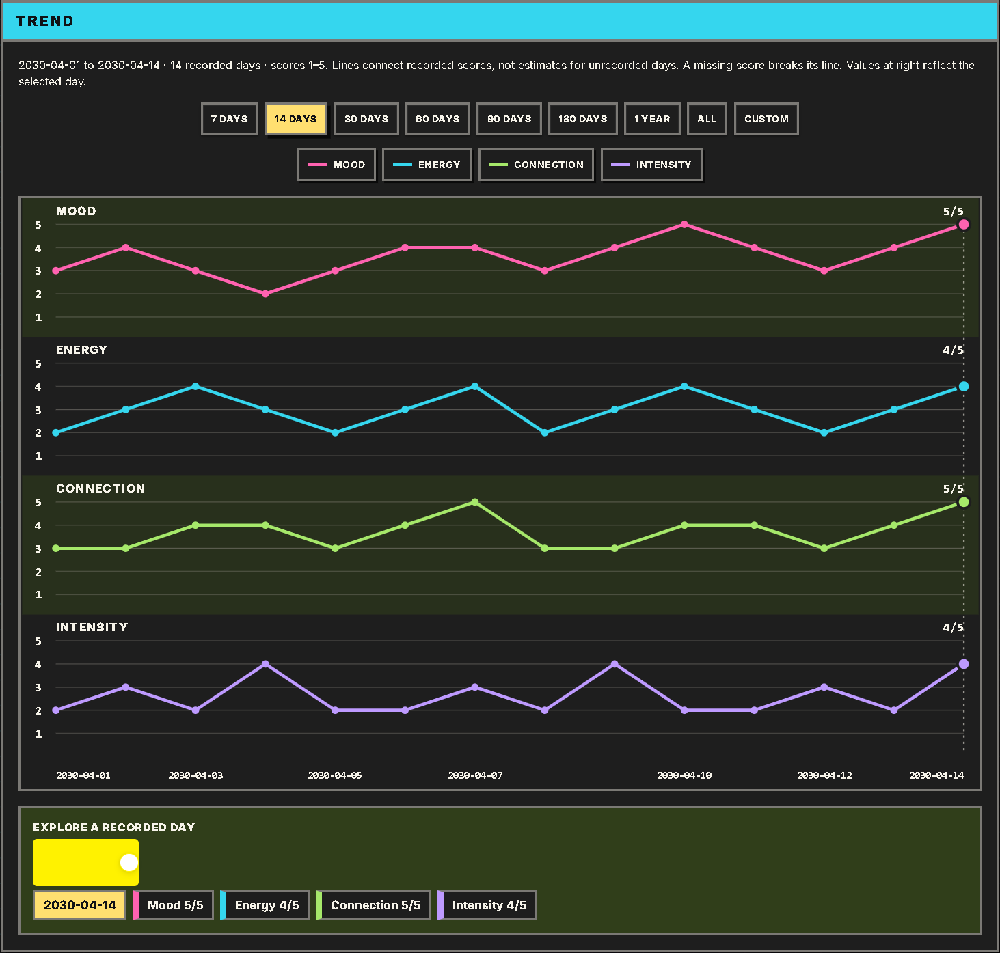
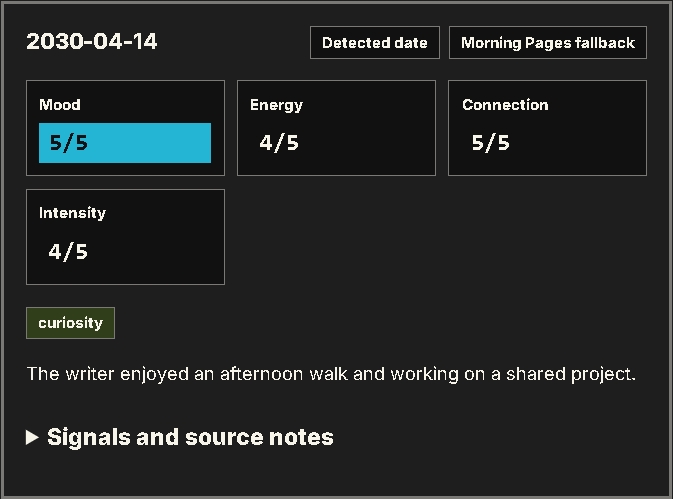

# Automatic Mood History

Explore mood, energy, connection, and intensity across your dated Obsidian notes. The plugin runs offline on desktop, Android, and iPhone. Optional cloud analysis supports Groq, OpenAI, Anthropic Claude, Google Gemini, and DeepSeek.

Both screenshots show the plugin running in Obsidian with fictional journal entries.

## Install

Download `main.js`, `manifest.json`, and `styles.css` from the [latest release](https://github.com/remriel/automatic-mood-history/releases/latest). Copy them into `.obsidian/plugins/automatic-mood-history/` inside your vault, restart Obsidian, and enable **Automatic Mood History** under **Settings → Community plugins**. Requires Obsidian 1.5 or later.

On mobile, you can also install through [BRAT](https://github.com/TfTHacker/obsidian42-brat) using the repository `remriel/automatic-mood-history`.

## Explore your history

1. Choose **Analysis scope** in the plugin settings. The default for new setups, **Scan all except excluded folders**, scans all eligible notes except those in listed folders. Choose **Include specific folders** to limit analysis to the folders you list. A blank include list pauses note analysis. A saved scope carries forward on upgrade. Each mode remembers its own list. Use one vault-relative folder per line. Rules include subfolders, and / matches only root-level notes. Notes with the same detected date contribute to one daily result. Undated filenames use the local creation date.
2. Open **Automatic Mood History: Open mood history dashboard** from the command palette and select **Analyze changed**. Enable automatic analysis in settings if you want future changes picked up.
3. Select a chart range or explore a day. Expand a month under **Day by day** to see summaries, scores, and source notes. Mood, energy, connection, and intensity use a 1–10 scale. Earlier 1–5 scores display as 1, 3, 6, 8, or 10 in the dashboard and refreshed monthly exports. The original values stay in saved history and recovery data. Days with insufficient evidence can appear in history without a plotted score.

## Monthly notes

With **Monthly notes** selected, each saved analysis updates its month. A completed scan also checks every month against saved history, even if the analysis found no changed notes. If a generated monthly note contains edits, the plugin saves and verifies an exact copy in **Preserved monthly notes** before refreshing the regular month. An unrelated file, an unreadable recovery block, or an export with newer or missing history stays in place for review.

## Choose an API provider

In **Settings → Automatic Mood History**, choose **API provider** and the matching key method:

- On desktop, set that provider's environment variable from the table before launching Obsidian. The environment key takes precedence over a saved key.
- On Obsidian 1.11.4 or later, enter the key in the masked provider key field and select **Save key**. Obsidian keeps keys in its secret storage. Configure a key on each device where you use cloud analysis.

Saving a key does not send notes or enable cloud analysis. Confirm that the model ID is available to your API account, then enable analysis for the selected provider. Switching providers turns analysis off until you enable it again. On the dashboard, **Check** followed by the provider name sends a fictional sample. **Analyze changed** sends eligible journal text.

| Provider | Default model | Desktop environment key |
| --- | --- | --- |
| Groq | `openai/gpt-oss-20b` | `GROQ_API_KEY` |
| OpenAI | `gpt-5.4-mini` | `OPENAI_API_KEY` |
| Anthropic Claude | `claude-haiku-5-5` | `ANTHROPIC_API_KEY` |
| Google Gemini | `gemini-3.5-flash-lite` | `GEMINI_API_KEY` |
| DeepSeek | `deepseek-flash` | `DEEPSEEK_API_KEY` |

Switching providers turns cloud analysis off. Each provider remembers its model and uses its own key. Existing Groq installations keep their configuration. Offline analysis uses Morning Pages word lists. If a cloud request fails, the plugin uses its existing local fallback and retry rules. It only contacts the selected service.

Past results keep their original analyzer. Use **Retry fallback entries** to revisit locally scored days or **Reanalyze all notes with selected provider** for a deliberate full rescan.

[Privacy and data handling](PRIVACY.md) · [Release history](https://github.com/remriel/automatic-mood-history/releases) · [MIT license](LICENSE)
